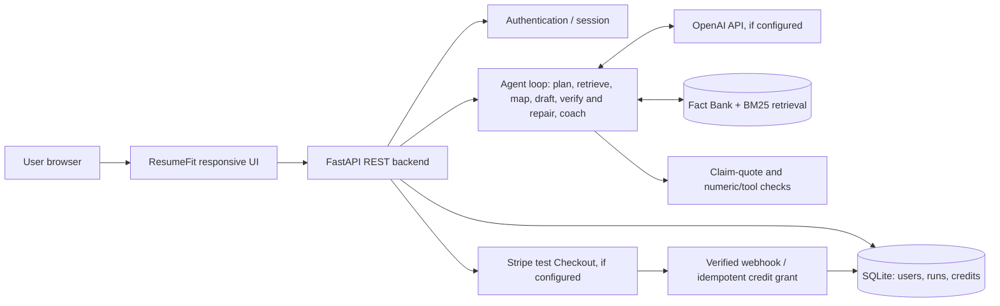

# ResumeFit Capstone — Final Demo & Presentation Outline

**Project title:** ResumeFit — A Fact-Grounded AI Resume Tailor

**One-liner:** Tailor a resume to a specific job description by highlighting *existing* experience, without fabricating credentials.

## Suggested 7-slide presentation

**Slide 1 — Problem & Why Now**
- Job applicants repeatedly rework resumes for different roles.
- Generic generators risk adding skills or outcomes applicants never claimed.
- Opportunity: targeted, traceable, low-friction editing.

**Slide 2 — Who We Serve & Product Value**
- Students, new graduates, early-career job seekers.
- Inputs: resume text and target JD. Outputs: relevant requirements, rewritten bullets, missing evidence, explanations.
- Differentiator: the user can see the original evidence for each rewrite.

**Slide 3 — Product Workflow**
1. Paste Resume + Target JD.
2. Extract job requirements.
3. Retrieve candidate evidence from the resume and the user's Fact Bank, and map each requirement to it by fact ID.
4. Rewrite up to 5 bullets, if the resume supports them; verify every claim against its source, repair or drop failures.
5. Show Before / After / Why Changed + Not Evidenced.
6. Save history; charge for successful AI-tailoring sessions.

**Slide 4 — System Architecture**

**Slide 5 — Working Implementation & Test Results**
- Authentication: successful local register/login and logout.
- Demo flow: accepted resume and JD, returned requirements and evidence-grounded bullets.
- History: saved and retrieved analyzed resume and JD for the authenticated user.
- Guardrails: tests reject unsubstantiated numeric claims and new named tools.
- **Important:** Only demonstrate real LLM responses after configuring and testing your own OpenAI API key. Do not claim live Stripe payments until configured and tested.

**Slide 6 — Live Demo (2 minutes)**
1. Register/login and show remaining credits.
2. Click both Try an example buttons; show inputs.
3. Click Tailor Resume; walk through requirements, before/after, missing items and summary.
4. Copy an improved bullet, download the report, and reopen it from History.
5. For a second JD, replace the JD and analyze again to demonstrate targeted output.
6. Point out the Demo/AI mode badge and explain what is actually connected.

**Slide 7 — Lessons Learned, Business Model & Next Steps**
- Lessons: factuality is harder than fluent text; data storage needs privacy measures; external API costs need credit accounting.
- Pricing hypothesis: 3 free credits; 5 AI credits for $4.99, subject to user validation and costs.
- Eval (real API, `eval/results.md`): on a low-match case the single-prompt baseline produced 3 flagged rewrites; the agent produced 0 and listed gaps. On a partial match the agent repaired a failing draft in 1 round.
- Next: embedding-based retrieval, better evidence verifier, PDF/DOCX upload parsing, usability study, rate limits, persistent hosted DB, deletion controls, live billing readiness.

## Three evaluation scenarios

| Case | Inputs | Expected behavior |
|---|---|---|
| Strong match | Resume mentions Python, SQL, Tableau; JD asks for all three | Those skills recognized, rewritten bullets preserve evidence |
| Partial match | Resume mentions Python analytics; JD asks for additional ML deployment | Partial/not evidenced rather than fabricated claims |
| Low match | Resume has general customer service; JD requires cloud engineering | Clearly indicate unsupported requirements; do not generate false AWS/DevOps claims |

## Important caveat

The shipped app has a real working demo pipeline, optional OpenAI integration, and Stripe test-mode integration points. A public web URL and successful third-party transactions require the project owner's credentials, setup, and validation. Do not present mockups, simulated AI responses or untested payments as live production features.
